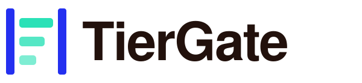

<p align="center">
  <picture>
    <source media="(prefers-color-scheme: dark)" srcset="packages/frontend/public/logotype-dark.svg">
    
  </picture>
</p>
<p align="center">
One OpenAI-compatible endpoint. Every request goes to the cheapest model that can handle it.
</p>

---

## What is TierGate?

TierGate is an open-source, self-hosted LLM gateway for AI agents and apps. You connect your API keys, subscriptions, and local models once. Your agent sends `"model": "auto"` to one endpoint, and TierGate picks the model.

- 🧭 Complexity routing: every request is scored and sent to a Simple, Standard, Complex or Reasoning tier
- 🎯 Task-specific routing: coding, web browsing, data analysis and other task types can have their own models
- 🔀 Default and custom (header) routing, with up to 5 fallbacks per tier
- 💾 Full request and response logs for success and error messages
- 📊 Cost tracking, notifications and limits per agent

TierGate is a fork of [Manifest LLM Gateway](https://github.com/mnfst/llm-gateway). It keeps complexity and task-specific routing turned on for every agent, while upstream is retiring them.

## Quick start

TierGate ships as a multi-arch (amd64 and arm64) Docker image: `ghcr.io/faisalahammad/tiergate`.

```bash
bash <(curl -sSL https://raw.githubusercontent.com/faisalahammad/tiergate/main/docker/install.sh)
```

Open [http://localhost:2099](http://localhost:2099) and create the first account. It becomes the admin.

Step-by-step guide for a VPS or your own machine, with HTTPS, backups and upgrades: **[docs/self-hosting.md](docs/self-hosting.md)**.

Setup for Docker, a VPS, Dokploy and Coolify on one page: **[faisalahammad.github.io/tiergate](https://faisalahammad.github.io/tiergate/)**.

## Providers

TierGate connects to **300+ models through 35 built-in provider connections** plus any custom OpenAI/Anthropic-compatible endpoint. Bring your own API key, reuse one of **18 subscription flows**, or run models locally. Everything is routed through the same OpenAI-compatible endpoint — send `"model": "auto"` and TierGate picks the model.

Provider catalogs are discovered dynamically when credentials are connected. The examples below are representative, not exhaustive.

| Provider                                                                                 | API key / local | Subscription                 | Model catalog                                                   |
| ---------------------------------------------------------------------------------------- | :-------------: | :--------------------------- | --------------------------------------------------------------- |
| [**OpenAI**](https://platform.openai.com/)                                               |       ✅        | ✅ ChatGPT Plus / Pro / Team | GPT-5.6 (Sol / Terra / Luna), GPT-5.5, GPT-5.4, Codex, o-series |
| [**Anthropic**](https://www.anthropic.com/)                                              |       ✅        | ✅ Claude Max / Pro          | Claude Opus 5, Sonnet 5, Fable 5, Haiku 4.5                     |
| [**Google**](https://ai.google.dev/)                                                     |       ✅        | ✅ Sign in with Google       | Gemini 3.5 Flash, 3.1 Flash-Lite, Gemini 2.5                    |
| [**Google Vertex AI**](https://cloud.google.com/vertex-ai)                               |       ✅        | —                            | Gemini models via Vertex AI                                     |
| **Gemini Free**                                                                          | ✅ Managed key  | —                            | Needs your own gateway in `CREDITS_BASE_URL`                    |
| [**Meta**](https://www.meta.ai/)                                                         |       ✅        | —                            | Muse Spark 1.2 / 1.1 + Contributor route (Meta Model API)       |
| [**xAI**](https://x.ai/)                                                                 |       ✅        | ✅ Grok subscription         | Grok 4.5, Grok 4.3, Grok Build, Grok 4.20                       |
| [**AWS Bedrock**](https://aws.amazon.com/bedrock/)                                       |       ✅        | —                            | Claude, GPT, Kimi, MiniMax, Nemotron, Nova via Bedrock          |
| [**Alibaba Cloud / Qwen**](https://www.alibabacloud.com/en/solutions/generative-ai/qwen) |       ✅        | ✅ Qwen Token Plan           | Qwen 3.7 Max / Plus / Flash, DeepSeek, Kimi, GLM                |
| [**DeepSeek**](https://www.deepseek.com/)                                                |       ✅        | —                            | DeepSeek V4 Pro, V4 Flash, V3.2, R1                             |
| [**Mistral**](https://mistral.ai/)                                                       |       ✅        | ✅ Mistral Vibe              | Mistral Large, Medium 3.5, Devstral, Codestral                  |
| [**Moonshot** (Kimi)](https://kimi.ai/)                                                  |       ✅        | ✅ Kimi Coding Plan          | Kimi K3, K2.7 Code, Kimi for Coding                             |
| [**MiniMax**](https://www.minimax.io/)                                                   |       ✅        | ✅ MiniMax Coding Plan       | MiniMax M3, M2.7, M2.5                                          |
| [**Xiaomi MiMo**](https://platform.xiaomimimo.com/)                                      |       ✅        | ✅ MiMo Token Plan           | MiMo V2.5 Pro, V2.5, Flash                                      |
| [**Z.ai**](https://z.ai/)                                                                |       ✅        | ✅ GLM Coding Plan           | GLM 5.2, GLM 5.1, GLM 5 Turbo                                   |
| [**BytePlus**](https://www.byteplus.com/en/activity/codingplan)                          |        —        | ✅ ModelArk Coding Plan      | Ark Code, Seed Code, GLM, Kimi, DeepSeek, GPT-OSS               |
| [**GitHub Copilot**](https://github.com/features/copilot)                                |        —        | ✅ Copilot subscription      | Claude, GPT, Gemini, Grok via Copilot                           |
| [**Kiro**](https://kiro.dev/)                                                            |        —        | ✅ Kiro subscription         | `kiro/auto`, Claude, DeepSeek, MiniMax, GLM, Qwen               |
| [**Command Code**](https://commandcode.ai/studio)                                        |        —        | ✅ Command Code subscription | Claude, DeepSeek V4, Qwen 3.7, Gemini, Kimi                     |
| [**ClinePass**](https://app.cline.bot/)                                                  |        —        | ✅ ClinePass subscription    | `cline-pass/glm-5.2`, Kimi, DeepSeek, MiMo, MiniMax, Qwen       |
| [**NousResearch**](https://portal.nousresearch.com/)                                     |        —        | ✅ NousResearch subscription | NousResearch Portal model catalog                               |
| [**OpenCode Go**](https://opencode.ai/)                                                  |        —        | ✅ OpenCode Go               | DeepSeek V4, Qwen 3.7, GLM, Kimi, MiMo                          |
| [**Ollama / Ollama Cloud**](https://ollama.com/)                                         |    🖥️ Local     | ✅ Ollama Cloud              | Local tags: Llama, Qwen, Gemma. Cloud: DeepSeek V4, GLM, Kimi   |
| [**LM Studio**](https://lmstudio.ai/)                                                    |    🖥️ Local     | —                            | Local GGUF models, port `1234`                                  |
| [**llama.cpp**](https://github.com/ggml-org/llama.cpp)                                   |    🖥️ Local     | —                            | Local GGUF models, port `8080`                                  |
| [**OpenRouter**](https://openrouter.ai/)                                                 |       ✅        | —                            | 300+ models across labs                                         |
| [**OpenCode Zen**](https://opencode.ai/)                                                 |       ✅        | —                            | Curated Claude, GPT, DeepSeek, MiMo, Nemotron                   |
| [**Kilo**](https://kilo.ai/)                                                             |       ✅        | —                            | Kilo Gateway catalog                                            |
| [**Cerebras**](https://www.cerebras.ai/)                                                 |       ✅        | —                            | GPT-OSS, GLM, Gemma on Cerebras inference                       |
| [**Fireworks AI**](https://fireworks.ai/)                                                |       ✅        | —                            | DeepSeek V4, Kimi K2.7, Qwen 3.7, Nemotron                      |
| [**Groq**](https://groq.com/)                                                            |       ✅        | —                            | Llama 4, Qwen 3.6, GPT-OSS, Gemma                               |
| [**Hugging Face**](https://huggingface.co/docs/inference-providers/)                     |       ✅        | —                            | Open models through Hugging Face Inference Providers            |
| [**NVIDIA NIM**](https://build.nvidia.com/)                                              |       ✅        | —                            | Nemotron 3, GLM, Kimi, MiniMax, Qwen                            |
| [**Pioneer**](https://pioneer.ai/)                                                       |       ✅        | —                            | OpenAI-compatible and fine-tuned Pioneer models                 |
| **Custom**                                                                               |       ✅        | —                            | Any `/v1/chat/completions` or `/v1/messages` endpoint           |

## Links

- [Setup site](https://faisalahammad.github.io/tiergate/)
- [Self-hosting guide](docs/self-hosting.md)
- [Docker reference](docker/DOCKER_README.md)
- [Contributing](CONTRIBUTING.md)
- [Upstream project: Manifest LLM Gateway](https://github.com/mnfst/llm-gateway)

## License

[MIT](LICENSE). TierGate is based on Manifest LLM Gateway, which is also MIT licensed. The original copyright notice is kept in [LICENSE](LICENSE).
